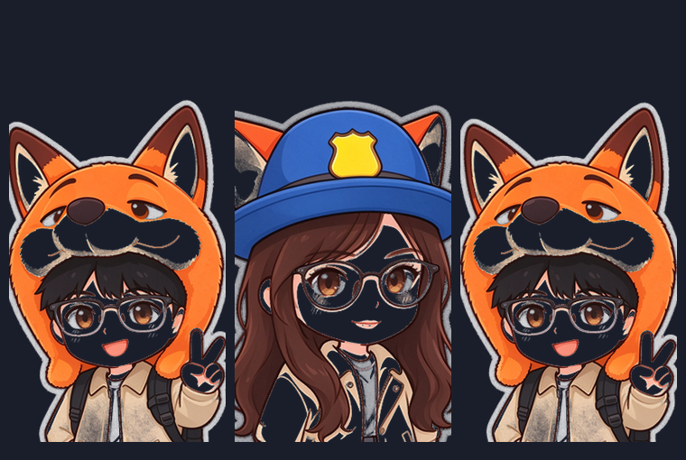

# dsh-deskpet 🐾

常驻 Windows 桌面的 DeepSeek Harness 桌宠：**独立透明置顶小窗**，DSH 收起来去干别的之后它照样在；DSH 干完活、要你确认、或者出错时它跳起来冒气泡告诉你；**点它一下就把 DeepSeek Harness 叫回前台**。

> 与社区插件 [dsh-pet](https://github.com/PC2005-cloud/dsh-pet)（那只蓝毛小女仆）取向不同：dsh-pet 是「住在 DSH 网页里 + 可选桌面形态」，本项目**只服务桌面形态**——因为目标场景就是「DSH 收起来，宠物还在，出事它来叫我」。
> 本目录是独立实现，只把 dsh-pet 当参考读物（只读），未复制其代码与素材。

---

## 它长什么样

两个形象（同一个主角，可右键随时切换）：


素材加工时发现的问题与修复前后对照（原素材的透明通道有洞，脸上像糊了一块黑面具）：




> 说明：实机运行截图（桌宠浮在桌面上的样子、工作状态气泡、系统通知、托盘点出来）
> 是在作者本人的桌面上截的，**含个人文件与聊天内容，因此没有随仓库发布**。
> 想自己看效果：装好之后把 DSH 关到托盘，点一下宠物就知道了。

---

## 架构：三个半边

```
┌─ DSH 宿主进程（Electron-as-Node，无 GUI）────────────────────────┐
│  src/host/  ← 编译成 lib/index.js                                │
│    · 配置读写（包内默认 → 用户层 main-config.jsonc）             │
│    · 形象扫描（assets/pet/<id>/idle.png + 用户 pet/<id>/）        │
│    · 监听 session/event → 工作状态(连续态) + 提醒(离散事件)       │
│    · 拉起/守护桌面助手，HTTP 路由给设置页用                       │
└───────────────┬──────────────────────────────────────────────────┘
                │  spawn（删掉 ELECTRON_RUN_AS_NODE）
                │  助手 → 宿主：stdout 一行一个 JSON
                │  宿主 → 助手：POST 到助手自建的 127.0.0.1 HTTP 回调
                ▼
┌─ 桌面助手：独立 Electron 进程（runtime/electron-helper/）────────┐
│    · 每只宠物一个透明置顶小窗，默认整窗点击穿透                   │
│    · 程序化动作片段：呼吸/漫游/拖拽抛掷/工作状态/提醒             │
│    · 点宠物 → Win32 SetForegroundWindow 把 DSH 叫回前台           │
└──────────────────────────────────────────────────────────────────┘
┌─ DSH 渲染进程（浏览器半边）──────────────────────────────────────┐
│  src/client/  ← 编译成 lib/client.js                             │
│    · 设置页「桌面宠物」区块（形象/大小/位置/开关/多开）           │
│    · 上报 DSH 窗口焦点 → 决定要不要弹系统通知                     │
└──────────────────────────────────────────────────────────────────┘
```

`package.json` 的 `dsh.bundle.patch` + `dsh.client` 是挂载声明，具体插进配置树靠
[cordis.patch.yml](cordis.patch.yml) 的一条 `insert`。这个结构和官方插件、以及
你已有的 `dsh-joi-channel-theme` 完全一致。

---

## 已实测可用

| 能力 | 状态 |
|---|---|
| 透明置顶桌面窗（DSH 最小化/被盖住后仍在） | ✅ 实机截图 |
| 点击穿透：整窗穿透，只有身体命中区内可交互 | ✅ |
| 两个形象 + 右键即时切换（换皮保持底边中心，不跳位） | ✅ 实机截图 |
| 换皮写回用户配置（重启后保持） | ✅ 集成验证 |
| 屏幕漫游 / 拖拽跟手 / 甩抛反弹 / 落地 Q 弹 | ✅ 代码就绪，手感待你试 |
| 工作状态联动：6 档（思考/干活/整理/等你确认/完成/出错） | ✅ 假宿主端到端验证 |
| 提醒：干完 / 出错 / 输出截断 / 等你批准 / 等你回答 | ✅ 实机气泡 + 截图 |
| DSH 不在前台时弹 Windows 系统通知，点通知唤起 DSH | ✅ 实机 toast + 截图 |
| 点击宠物唤起并聚焦 DSH（按 pid 或进程名定位窗口） | ✅ 窗口定位已验（`dryRun` 实测 hwnd/标题正确） |
| **DSH 缩在托盘里时，点宠物把窗口显示出来并抢到前台** | ✅ 实机验证：隐藏窗口 → 模拟真实鼠标点击宠物 → `可见=True 在前台=True`，日志 `点击宠物 → shown` |
| **DSH 退出后宠物仍留在桌面上；此时点它直接把 DSH 启动起来** | ✅ 实机验证：杀掉宿主后宠物存活并进孤儿模式；启动分支 7 项自测全过（含"DSH 正在运行时绝不启动第二个实例"） |
| 设置页 GUI：形象 / 大小 / 角落 / 边距 / 开关 / 多开 | ✅ 已构建，保存即重启助手生效 |
| pet pack：往用户目录丢 `pet/<id>/idle.png` 即出现新形象 | ✅ 扫描逻辑已验 |
| 多宠物同屏（`pets[]` 每只一个窗） | ✅ 代码就绪，未实机多开验证 |

### 🔌 DSH 不在眼前时：托盘 / 最小化 / 已退出

宠物的存在意义就是「DSH 不在眼前时它还在」。点它一下，几种情况都能把 DSH 弄回来：

| 当时的状态 | 点宠物会发生什么 |
|---|---|
| DSH 窗口可见（前台/后台） | 叫回前台 |
| 最小化 | `SW_RESTORE` 还原并抢前台 |
| **缩在托盘里（窗口被 hide，HWND 还在）** | **`SW_SHOW` 把窗口显示出来并抢前台**，气泡："从托盘里叫回来啦～" |
| 进程在、但确实没有窗口（正在启动等） | **不启动第二个实例**，气泡提示你去看任务栏 |
| **已经退出** | **直接启动它**，气泡："正在打开 DeepSeek Harness…" |

进入孤儿模式（DSH 已退出）时宠物会冒一句「DSH 关掉啦，点我就能打开～」，右键菜单那行也会从「唤起」变成「打开」。

两个实现要点，都是踩出来的（见下面平台坑表）：

- **枚举窗口时必须把不可见的也算上。** 缩托盘不是销毁窗口，而是 `hide()`：HWND 还在、标题还在，只是 `IsWindowVisible = false`。只枚举可见窗口就会漏掉它，于是"托盘里叫不出来"。
- **抢前台得由助手派生的 PowerShell 来做。** Windows 只允许「当前前台进程本身」或「由前台进程启动的进程」调 `SetForegroundWindow`。你点宠物 → 宠物窗口被激活 → 助手成为前台进程 → 它派生的 PowerShell 才有权抢前台；纯后台链路（比如我在终端里跑脚本）抢不到，这是实测对比确认过的。

DSH 下次启动时，新宠物会先读 `$DSH_HOME/dsh-deskpet/helper.json` 把旧的那只请出去，**桌面上不会出现两只**。想立刻收掉它：右键宠物 → 退出桌宠。

### 端到端是怎么测的

真装进 DSH 需要重启 DSH，而这个会话本身跑在 DSH 里——重启等于把自己掐了。
所以写了 [scripts/dev-host-harness.mjs](scripts/dev-host-harness.mjs)：一个**假 DSH 宿主**，
复刻 DSH 提供给插件的三样东西（`webServer.register` / `ctx.on` / `ctx.effect`），
然后加载**真实的构建产物** `lib/index.js` 跑起来——真配置、真形象扫描、真 spawn Electron、
真命令通道、真事件映射、真 HTTP 路由。上面那些 ✅ 就是这么来的。

```powershell
node scripts/dev-host-harness.mjs
# 另开一个窗口驱动它（端口见启动输出）：
Invoke-RestMethod http://127.0.0.1:<port>/dsh-deskpet/config
Invoke-RestMethod -Method Post http://127.0.0.1:<port>/ctl/event -ContentType application/json `
  -Body '{"session":"s1","event":{"type":"turn/start"}}'
Invoke-RestMethod -Method Post http://127.0.0.1:<port>/ctl/event -ContentType application/json `
  -Body '{"session":"s1","event":{"type":"turn/end","data":{"reason":{"kind":"completed"}}}}'
Invoke-RestMethod -Method Post http://127.0.0.1:<port>/dsh-deskpet/dev/notice -ContentType application/json -Body '{"kind":"approval"}'
```

---

## 安装

`dsh` 不在 PATH（DSH 是桌面客户端形态装的），所以用自带脚本改 profile：

```powershell
cd E:\dsh-plugin\dsh-pet
node scripts/install-into-profile.mjs            # 装进 desktop profile（会先备份 package.json）
node scripts/install-into-profile.mjs --dry-run  # 只看会改什么
node scripts/install-into-profile.mjs --remove   # 卸载
```

**装完必须重启 DeepSeek Harness 才生效**（插件层在启动时构建配置树）。

> ⚠️ 你机器上已经装了社区版 `dsh-pet`，**两个插件会各画一只宠物**。
> 建议先右键 dsh-pet 那只 → 退出桌宠，或把它从 profile 的 bundles 里去掉。

卸载后插件在本机留下的东西：

- `$DSH_HOME/dsh-deskpet/` —— 用户配置 `main-config.jsonc`、形象 `pet/`、助手日志 `helper.log`
- `%APPDATA%\dsh-deskpet-helper\` —— 助手窗口缓存（可删，会自动重建）
- `lib/`、`node_modules/` —— 构建产物与开发依赖（本目录内，删了重新 build 即可）

---

## 开发

```powershell
pnpm install
pnpm run build        # tsdown：lib/index.js（宿主 ESM）+ lib/client.js（客户端 IIFE）
pnpm run typecheck    # 宿主半侧 strict，客户端半侧单独放宽口径（见 tsconfig.client.json）

# 不经过 DSH，直接把桌面宠物跑起来
node scripts/start-helper.mjs
node scripts/start-helper.mjs --species policegirl          # 指定形象
node scripts/start-helper.mjs --switch-after 8 policegirl   # 8 秒后走命令通道换皮
node scripts/start-helper.mjs --dsh-pid <pid>               # 指定「唤起 DSH」的目标
node scripts/start-helper.mjs --dsh-exe "<exe 路径>"        # 指定 DSH 退出后要启动的程序
node scripts/start-helper.mjs --orphan-after 1              # 直接进孤儿模式（验证「点宠物启动 DSH」）

# 自测
node scripts/test-bom.mjs      # 配置 BOM 容错
node scripts/test-launch.mjs   # 「点击宠物」全部分支（不启动真 DSH、不抢焦点）

# 重新加工形象素材（顺序对应 scripts/prepare-pets.py 里的 SPECIES）
python scripts/prepare-pets.py <图1> <图2>
```

调试要点：

- 助手是 GUI 程序，**PowerShell 直接调用不会等它**（GUI 子系统特性），要用 `Start-Process -PassThru` 或 `start-helper.mjs`
- 日志同时走 stdout 与 `$DSH_HOME/dsh-deskpet/helper.log`，排障先看它
- 右下的 http 接口：`GET /dsh-deskpet/config`、`GET /state`、`PUT /config`、`POST /focus`、`POST /dev/notice`、`POST /dev/work`

---

## 踩过的平台坑（都是实测结论，别改回去）

| 约束 | 证据 | 应对 |
|---|---|---|
| **DSH 插件宿主没有 GUI 能力** | 宿主进程以 `ELECTRON_RUN_AS_NODE=1` 启动、无 GPU/渲染子进程（实测环境变量与进程树） | 宠物必须跑在**独立 Electron 进程**里，不能在宿主里开 `BrowserWindow` |
| **spawn 助手时必须删掉 `ELECTRON_RUN_AS_NODE`** | 不删则 `electron.exe main.js` 以纯 Node 启动，`require('electron')` 直接 `MODULE_NOT_FOUND`（已复现报错栈；dsh-pet issue #63 同因） | `helper-process.ts` / `start-helper.mjs` 里 `delete env.ELECTRON_RUN_AS_NODE` |
| **Electron 主进程在 Windows 读不到 piped stdin** | electron#4218。实测：宿主写管道，助手 stdin 立刻 `end`、0 条 data；同一重定向方式下纯 Node 进程能正常读到 | 宿主 → 助手 改走**助手自建的 127.0.0.1 HTTP 回调**，地址经 stdout 上报 |
| **透明置顶窗不能铺满屏幕** | dsh-pet 文件头记录了 Windows DWM 视频合成黑屏的四条件 | 窗口只包住宠物本体 + 留白，永不全屏 |
| **DSH 主窗口进程 = 插件宿主进程的父进程** | 实测进程树：`DeepSeek Harness.exe(29672) → dsh-desktop-host(12104) → 宠物` | 把 `process.ppid` 传给助手按 pid 精确定位；拿不到时按进程名兜底 |
| **`dsh plugin` 不在 PATH** | 实测 `Get-Command dsh` 为空 | 自带 `install-into-profile.mjs` 直接改 profile + pnpm install |
| **日志目录不存在会静默吞掉全部日志** | 实测：`appendFileSync` 抛错被 catch 掉，排障时最要命 | 宿主启动时 `mkdirSync(userRoot)`，助手也自建一次 |
| **Windows 上不设 `detached: true`，父进程一死子进程就被带走** | Node 文档原文：*On Windows, setting `options.detached` to true makes it possible for the child process to continue running after the parent exits.* 实测：不加它，宿主一被杀宠物立刻消失，孤儿模式根本来不及生效 | spawn 助手时 `detached: true` + `child.unref()` |
| **宿主一退出，stdout 读端关闭 → 宠物写日志拿到 EPIPE → Node 当未处理错误把进程崩掉** | 实测：不处理时宠物在宿主死后凭空消失、连一行日志都没留下；dsh-pet 的 `host-liveness.js` 记录了同一个坑 | 给 `process.stdout/stderr` 挂 `'error'` 吞掉 EPIPE，并把它当作"宿主没了"的信号（比轮询更及时） |
| **DSH 加载过插件后 profile 里的目录被占用，pnpm 替换它会 EPERM** | 实测：`forceSymlink`/rename 报 `EPERM`，连空目录都删不掉；且 pnpm 只按 name+version 判断更新，版本没变就永远 `Already up to date`，于是默默跑旧副本 | 安装脚本在目录已存在时**就地覆盖文件**（不替换目录），装完用 sha256 校验产物与源码一致，不一致直接报错退出 |
| **配置文件的 UTF-8 BOM 会让 `JSON.parse` 直接抛错** | 记事本、PowerShell `Set-Content -Encoding UTF8` 都会加 BOM；实测宿主读到带 BOM 的配置会整份回落默认 | `stripJsonc` 先剥 BOM；补了 5 项自测（`scripts/test-bom.mjs`） |
| **托盘里的窗口是 `hide()`，不是销毁** | 实测：DSH 主进程的主窗口 `Chrome_WidgetWin_1` 隐藏后 HWND 与标题都还在、`IsWindowVisible=false`；同进程里还有 `Electron_NotifyIconHostWindow`（托盘图标就来自它） | 枚举窗口时**包含不可见窗口**，选中后 `SW_SHOW` 再抢前台 |
| **`SetForegroundWindow` 有严格权限门槛** | 实测对比：终端链路（pwsh→node→powershell）抢前台失败 `focused=false`；而**模拟真实鼠标点击宠物**后同一条代码返回 `focused=true`。规则是只有「前台进程本身」或「由前台进程启动的进程」有权改前台窗口 | 由助手（被点击后才成为前台）派生 PowerShell 执行；再依次兜底 `AttachThreadInput` → `SwitchToThisWindow` |
| **窗口销毁后再读 `win.webContents.id` 会抛 `Object has been destroyed`** | 实测：助手退出时 `closed` 回调里读它，刷出一串 uncaughtException | 建窗时先把 `webContents.id` 存进闭包；光标轮询整体加 try/catch 防销毁竞态 |

---

## 已知限制

- **系统通知的标题显示为 "Electron"**：未打包的 electron.exe 没有注册 AppUserModelID 对应的开始菜单快捷方式，Windows 就用默认名。功能不受影响（图标与正文都正常）；要改需给 exe 建快捷方式或改用自绘提醒窗。
- **Electron 自动下载路径未在本机验证**：本机已有 `~/.dsh/electron/electron.exe`（dsh-pet 下载的），代码里那条 `DSH_DESKPET_ALLOW_DOWNLOAD=1` 分支走不到。缺运行时时默认只告警不自动下。
- **多屏**：目前只用主显示器工作区。跨屏抛掷、多屏 DPI 异构缩放（Windows 上最容易出鬼的地方）都没做。
- **多宠物同屏**：配置与建窗逻辑支持，但没实机开过多只。
- **客户端半侧类型口径放宽**（`tsconfig.client.json`）：它是 React/DOM 胶水层，元素工厂 `h` 的手写重载无法让每个内联回调都拿到上下文类型。数据模型仍是显式声明的。
- **素材是静态图**，所有"动作"都是程序化形变（呼吸/倾斜/蹦跳/挤压/抖动）。要真正的逐帧动画，需要接 webm/序列帧素材管线。

---

## 配置

用户层：`$DSH_HOME/dsh-deskpet/main-config.jsonc`（设置页与右键菜单都会写它，也可手改）。
完整字段与注释见包内 [assets/config.jsonc](assets/config.jsonc)。

```jsonc
{
  "pets": [
    {
      "id": "main",              // 唯一标识
      "name": "阿狐",            // 显示名
      "species": "foxboy",       // 形象 id（= assets/pet/<id>/ 或 用户 pet/<id>/）
      "size": 190,               // 宽度（px），高度按素材比例自动算
      "position": { "corner": "bottom-right", "marginX": 24, "marginY": 24 }
    }
  ],
  "roamEnabled": true,           // 屏幕漫游
  "workStatusEnabled": true,     // 跟着 DSH 干活状态变姿势（纯监听，零 token）
  "notifyEnabled": true,         // 提醒气泡
  "notifySystemToast": true,     // DSH 不在前台时额外弹系统通知
  "clickToFocusDsh": true,       // 点一下宠物唤起 DSH
  "roam": { "minDist": 80, "maxDist": 260, "speed": 70, "pauseMinSec": 8, "pauseMaxSec": 22 },
  "physics": { "gravity": 2400, "restitution": 0.55, "groundFriction": 3.4, "throwPower": 1 },
  "workStatusTexts": [ ["正在想呢…"], ["正在干活，别打扰我～"], ["搞定一步，继续～"],
                       ["轮到你来决定啦，等你～"], ["这一轮搞定啦！"], ["好像卡住了呢…"] ]
}
```

### 加自己的形象（零配置 pet pack）

```
$DSH_HOME/dsh-deskpet/pet/
└─ mypet/
   ├─ idle.png                          透明背景 PNG，底边贴脚
   └─ species.json                      {"name":"我的宠物"}（可选，缺省用目录名）
```

放进去 → 设置页刷新就能在下拉里看到，右键菜单也会多一项。
建议：宽高比尽量接近竖构图，人物底部贴住图片下边缘（宠物是"站"在图片底边上的）。

---

## 许可

代码 MIT。`assets/pet/` 下的两张形象素材来自你提供的原型图（豆包 AI 生成），仅供自用。
